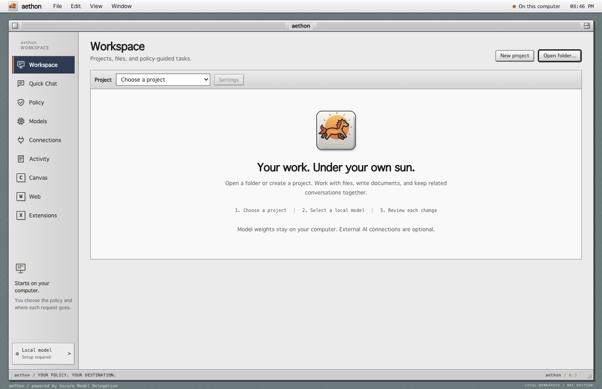
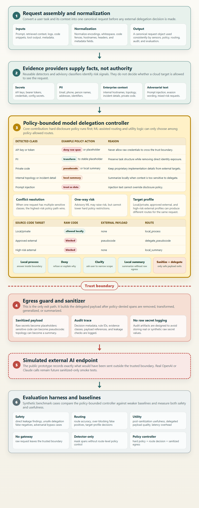

# aethon

**A local-first desktop workspace powered by Secure Model Delegation**

This repository contains the aethon local-first desktop application, an editable research paper,
and the preserved synthetic evaluator from a Georgia Tech CS6727 project.
The application generates actual local AI answers and optionally calls OpenAI
or Anthropic, or a user-owned OpenAI-compatible endpoint. The historical evaluator records simulated payloads; its reported
research results do not evaluate the new application.

The application uses local-model evidence and deterministic checks, with
human-reviewed policy rules controlling permitted paths. Its design rule is:

```text
Evidence first, policy authority always.
```



## Install aethon on Mac

The desktop deliverable is `aethon.app` inside `aethon-arm64.dmg`, for Apple
Silicon and macOS 15 or later. Drag the app to Applications and open it from
Finder or the Dock. Python, Node, Bun, Ollama, Microsoft Office, and a separate
browser are not end-user requirements.

The first release is an ad-hoc-signed development test build, not a Developer
ID-signed or notarized public release. See the
[desktop installation and rebuild guide](docs/desktop-installation.md) for the
exact setup, storage behavior, supported tools, and distribution limitations.

- Choose and download a compatible GGUF or MLX model inside the app. No model
  chat or speech model weights are included or selected automatically. Small
  auxiliary classifier resources are identified in the package manifest.
- Review and activate a natural-language information policy, then work in
  projects and sessions. Project file changes and commands require approval.
- Use the file editor, supervised terminal, structured document tools, local
  Office-to-PDF renderer, Canvas, Skills/MCP manager, and optional local dictation.
- Connect an external API only when needed. SMD checks the supported model
  request envelope, including earlier turns and tool results, and exposes its
  routing and provider-adapter record.

The original sun-horse identity and Platinum interface belong to aethon.
Secure Model Delegation remains the research and routing component's name.

## Run From Source

For development or the cross-platform browser interface, use Python 3.11 or newer. Clone this repository, open its folder, and run
with that Python version (`python3.12` can replace `python3` if the system
`python3` is older):

```bash
python3 -m venv .venv
.venv/bin/python -m pip install -e .
.venv/bin/smd serve
```

Windows PowerShell:

```powershell
py -3.11 -m venv .venv
.venv\Scripts\python -m pip install -e .
.venv\Scripts\smd serve
```

The browser opens at `http://127.0.0.1:6728`. Use `smd serve --port 6730`
for another port or `--no-browser` to open the address yourself. Keep the terminal
running; Ctrl+C stops the service and its managed model process.

For Canvas and PDF previews in a fresh source checkout, also run
`npm --prefix frontend ci` and `npm --prefix frontend run build`.
The workspace agent, MLX and Office rendering use the prepared runtimes described
in the desktop build guide. The complete Mac installer already includes them.

1. Open Models to browse the live Hugging Face catalog. Search by model or
   publisher and sort by latest updates or download count. No model is bundled,
   selected, or downloaded on first launch.
2. Open a repository, inspect its license, file size and available GGUF
   variants or MLX repositories, and click Download for the selection you want. The application prepares
   its own verified runtime and downloads the model. In Installed models, click
   Use to activate it after a local execution check. Structured-output and tool
   support vary and are validated per operation. A
   separate Ollama installation is not required. Changing model families does
   not require changing the application or policy code. Advanced selection also
   accepts official Ollama registry tags. MLX support in the complete Mac desktop distribution uses its bundled oMLX helper.
3. A conservative example policy is active initially. In Policy, write short
   natural-language clauses, save and interpret the draft locally, review the
   source clauses and interpreted rules, then activate the revision. Unsupported
   or conflicting drafts cannot replace the active policy.
4. Enter a prompt in Chat and click Submit. The app inspects the whole
   conversation, selects a permitted path, generates an answer, and shows actual
   progress. Details show applied rules, transformations, and any outgoing
   message bundle. New Chat resets the conversation.
5. Optionally add an OpenAI API key, Anthropic API key, or your own compatible remote endpoint and a model ID in
   Connections, then select that external destination in Chat. No separate
   per-request send confirmation is required: Submit executes the active policy.
   A configured API enables delegation; it does not force it. The default is
   local-first, with external use only when the local model estimates that it
   needs additional help and the policy permits the transformed request.

Without an API connection, supported requests are answered locally. After the
initial downloads, this local-only workflow can run offline. Denial and
clarification remain valid policy outcomes. Model errors, failed checks, or
timeouts never trigger a raw-message or alternate-provider retry.

The model browser follows the discover, choose a variant, download, and load
workflow described in [LM Studio's documentation](https://lmstudio.ai/docs/cli/local-models/get).
It uses [Hugging Face's public catalog](https://huggingface.co/docs/hub/en/api)
and its [native Ollama GGUF integration](https://huggingface.co/docs/hub/ollama),
not a fixed list of three model families. Model search terms and metadata
requests go to the Hub; policy and conversation text do not. Catalog errors do
not prevent use of models already installed on the computer.

The application exposes compatible GGUF and MLX candidates, with runtime-specific capability checks. The complete Mac desktop bundle includes both model engines; source-only environments need the corresponding prepared runtime. Not every public model has a compatible architecture, file
layout, license, hardware requirement, or structured-output behavior. The app
reports unavailable or unsupported variants and checks selected models rather
than claiming that every open model can run. Downloading and activating are
separate actions. Download size is not a memory requirement guarantee; runtime
downloads and unpacked files also require disk space. Cloud models and
arbitrary download hosts are rejected.

### Policy And Observation Limits

The first policy schema supports named recipients (`local`, `openai`,
`anthropic`, `remote`), a fixed set of information categories, and allow, redact,
local-only, deny, or clarification actions. It does not enforce provider
contracts, geographic processing, retention periods, arbitrary programs, or
unlimited exceptions. Human review of compiled rules is required. Credential
removal before external delegation is a fixed protection that a model or
policy draft cannot disable.

Local sensitivity classification and local capability estimates can be wrong.
If the local inspection cannot validate its structured result or ground a
quoted finding, external delegation is disabled. The app can still answer
locally when local policy permits it; uncertain local deny/clarification
conditions require clarification instead. Details identify unreliable or
uncertain inspection rather than presenting it as a completed security check.
The final inspection checks recognized protected spans in the entire outgoing
message bundle, including previous turns and the app's fixed system message.
It does not prove semantic confidentiality. Code removal uses placeholders,
not verified meaning-preserving pseudocode generation. Oversized conversations
are refused rather than silently dropping earlier turns.

Quick Chat uses the OpenAI Responses API with `store=false`; the agent adapter uses the Chat Completions interface and also sets `store=false`. These options are not guarantees about all provider retention. Anthropic uses the Messages API. A timeout after
dispatch is recorded as delivery-unknown; cancellation cannot recall an
already dispatched request. Provider model availability and billing depend on
the user's API account. ChatGPT or Claude Code sign-in is not imported.

### Local Data And Model Lifecycle

Policies, model files, and metadata are stored outside the repository:

- macOS: `~/Library/Application Support/SecureModelDelegation`
- Windows: `%LOCALAPPDATA%\SecureModelDelegation`
- Linux: `~/.local/share/SecureModelDelegation`

Use `smd serve --data-dir <directory>` for a different application directory.
By default, prompt, answer, and outgoing-body content remain in memory; Activity
persists only hashes, versions, path and dispatch metadata. Enabling content
storage saves future run contents, including their conversation context, on
this computer. Clear Activity deletes saved runs and in-memory conversations.
API keys remain in server memory and are cleared when the app stops; they are
never saved with conversations or browser storage.

The managed runtime is pinned to Ollama v0.40.13 with published per-platform
SHA256 checks. It runs on a private loopback port with cloud functionality and
request-body debugging disabled. The app does not register a service, change
PATH, or modify another Ollama installation. Ollama itself may create
`~/.ollama/id_ed25519` and `.pub` on startup; the application does not delete or
overwrite those shared files. Remove models through Models. To remove all
application data, stop the app and delete only its application data directory.

The complete aethon desktop bundle requires Apple Silicon and macOS 15+. The legacy GGUF source interface requires macOS 14+; Apple Silicon supports CPU/GPU and
Intel Mac uses CPU. Windows 10 22H2+ and compatible Linux amd64/arm64 use the
same managed installation approach. Existing compatible GPU drivers may be
used; installing system GPU drivers is outside the app. Unsupported platforms,
insufficient memory, and interrupted downloads are reported in the setup UI.
Runtime, model, and application licenses remain separate; model license
metadata is displayed when supplied by the publisher. Public availability is
not treated as proof of an open-source license. No model weights are committed
to this repository.

This version is for each user on their own computer. It binds to loopback,
validates browser origin/host and a local session token, and does not expose a
shared multi-user server or hosted proxy. All interface assets are local.

## Application Tests And Research Provenance

```bash
.venv/bin/python -m unittest discover -s tests -p 'test_app_*.py' -v
.venv/bin/python -m pip install build
.venv/bin/python -m build
```

Application tests use local model and provider doubles without paid API calls
or multi-GB downloads. Real model/device smoke checks and actual provider
checks must be reported separately from those tests. The CI matrix covers
Python 3.11/3.12 on macOS, Windows, and Linux; a workflow definition is not
evidence that every device or architecture has been exercised.

Earlier browser-application implementation checks on October 31, 2026: 132 unit/integration tests
passed on macOS arm64; the wheel was built and opened outside the source tree
with its packaged browser assets. The managed runtime and an explicitly chosen
Qwen3 4B were downloaded, then a different family (SmolLM2 360M, Q4_K_M) was
discovered and downloaded through Hugging Face. Separate activation and actual
local answers were checked for both, along with policy draft review/activation
and a synthetic two-turn context check. These are software smoke checks, not a
new benchmark or independent policy-accuracy study. Live external API calls and
physical Windows/Linux model execution were not performed in these local checks.

The historical CI job checks out exactly
`47068049ad690950c0f516955960e0b3a1aebba2`, whose protected core matches the
original freeze reference. Before this application work, main at `eb48dc0`
already differed from `d1d13cd` in two protected files: `configs/policy.yaml`
(advisory ML notes) and `src/smd_gateway/policy.py` (a rule-name change).
Historical job results do not certify current HEAD as the frozen controller.
Application CI separately verifies that this work did not change research
code, policies, labels, datasets, or paper files from `eb48dc0`.

## Korean Manuscript Collaboration

The public [Korean manuscript workspace](paper/korean/README.md) contains the
editable [LaTeX draft](paper/korean/secure-model-delegation-ko.tex), vector
figures, figure generator, and a downloadable
[source bundle](paper/korean/secure-model-delegation-ko-source.zip).
Junkuk Kim and Jinyoung Choi can use this publication draft for collaborative
editing through branches and pull requests.

The manuscript distinguishes authored evaluation metrics, generated candidate
text, and locally recorded mock bodies. It does not claim actual network
receipt or independently validated semantic confidentiality. The public package
contains no original practitioner prompts, private source mappings, reviewer
response files, or private analysis reports. The existing executable evaluation
data in this repository remains synthetic.

## Architecture At A Glance



Diagram source: `docs/assets/secure-model-delegation-architecture.html`.

## Decision Model

The core decision problem is not whether the gateway can detect sensitive text.
The core problem is deciding how an AI request should cross, or not cross, a
model boundary.

At a high level, the controller is modeled as a constrained route function:

```text
R = f(E, P_t, U)
```

Where:

- `R` is the final route decision.
- `E` is the set of detected evidence signals in the request, such as API keys,
  authentication tokens, PII, internal hostnames, source code, incident details,
  or prompt-injection text.
- `P_t` is the target-specific disclosure policy for the intended model target,
  such as a trusted local model, an approved external AI target, or a high-risk
  external target.
- `U` is an advisory utility estimate of whether a transformed request is still
  useful enough to delegate.

More explicitly:

```text
A(E, P_t) = {r in Routes | Safe(r, E, P_t) = true}
R = f(E, P_t, U) = argmax_{r in A(E, P_t)} U(r)
```

Where:

- `Routes` is the set of possible handling decisions.
- `Safe(r, E, P_t)` is true only when route `r` satisfies hard disclosure
  policy for the target profile.
- `A(E, P_t)` is the policy-allowed route set.
- `U(r)` ranks only policy-allowed routes. It does not authorize unsafe routes.

The current prototype makes the utility term explicit and route-specific:

```text
U(r | X, t) =
    0.45 * task_adequacy(r, X)
  + 0.25 * information_retention(r, X)
  + 0.20 * model_capability_fit(r, t)
  - 0.10 * operational_cost(r, t)
```

All components are normalized to `[0, 1]`. The default weights and route costs
are versioned in `configs/policy.yaml`. They are operational assumptions rather
than universal constants, so the evaluation includes alternate weight profiles.
Weight changes can alter which allowed route wins, but they cannot reintroduce a
route removed by hard policy.

In other words, the controller first removes routes that violate policy, then
chooses the most useful remaining route. The core safety invariant is:

```text
forall r notin A(E, P_t): f(E, P_t, U) != r
```

This means that advisory evidence, ML scores, or utility estimates cannot select
a route that the target-specific policy forbids.

This encodes a bounded route-safety invariant by construction. It does not prove
that evidence detection is perfect or that all semantic leakage is impossible;
those risks are evaluated separately through benchmark tests and limitations.

The controller returns one of a small set of route decisions:

| Route | Meaning |
| --- | --- |
| `local_process` | Keep the request inside the trusted local/private boundary. |
| `deny_request` | Refuse the request because the policy risk is too high. |
| `ask_clarification` | Ask the user to narrow or clarify the request before routing. |
| `local_summary` | Produce a local-only summary without external delegation. |
| `delegate_sanitized_to_external_ai` | Send only a sanitized payload to the simulated external target. |
| `delegate_pseudocode_to_external_ai` | Send only pseudocode or a generalized problem statement to the simulated external target. |

The policy order is intentional. Hard disclosure policy is applied before
advisory routing. Evidence providers, ML-assisted scores, and utility heuristics
can inform the decision, but they do not have authority to override
policy-denied content. Runtime policy is loaded and validated from
`configs/policy.yaml`; detector code supplies evidence rather than duplicating
route authority.

For example, source code can be handled differently depending on the target:

| Target profile | Source-code policy | Resulting route |
| --- | --- | --- |
| `local_private` | Raw code may be used locally. | `local_process` |
| `approved_external_ai` | Raw code cannot cross the boundary; convert to pseudocode or a generalized problem statement. | `delegate_pseudocode_to_external_ai` |
| `high_risk_external_ai` | No code-derived external payload is allowed. | `local_summary` |

This is the main distinction from a generic privacy filter. A detector might
say "this span looks sensitive." The Secure Model Delegation controller decides
what model target, if any, may receive the request and in what form.

## Historical Evaluator Scope

- Text-only synthetic enterprise requests.
- Trusted local gateway running in Python.
- External AI is represented as a policy target profile, not a provider-specific
  route.
- Current target profiles include `local_private`, `approved_external_ai`, and
  `high_risk_external_ai`. The legacy `external_ai` profile is treated as an
  approved external profile for compatibility.
- Primary external target is a simulated endpoint that records sanitized or
  pseudocode-based delegated payloads for leakage evaluation.
- Real provider API calls are out of scope for the historical evaluator and remain
  optional sanitized-only future smoke tests.
- Provider no-training, retention, residency, and contractual controls are
  modeled as target assurances that may narrow external eligibility. They do not
  override hard content policy or make prohibited raw disclosure acceptable.
  The proposed attributes are documented in
  [Target-Profile Assurance Model](docs/target-profile-assurance.md).
- Route and transport are separated. For example, a request can use route
  `delegate_sanitized_to_external_ai` through transport
  `simulated_external_endpoint`.
- The controller resolves span-level actions into request-level routes using
  transformed payload safety plus remaining utility.
- Source-code requests demonstrate target-specific control: raw source code can
  be processed by a trusted local/private model, approved external targets get
  a deterministic structural abstraction when safe or a generalized problem
  statement otherwise, and high-risk external targets receive local summary
  only. Every result records the actual `transformation_type`.
- Delegated payloads pass through a fail-closed egress guard based only on
  runtime-detected evidence. Benchmark ground truth is reserved for post-hoc
  evaluation and cannot change whether a request is sent.
- Stable placeholders preserve repeated-value relationships within a request,
  while the reversible mapping remains local. The simulated endpoint records
  the exact wire-body digest and byte count for auditability.
- The legacy configuration's ML evidence block describes a proposed advisory
  layer; the historical evaluator does not load a local model. The new
  application implements local-model inspection separately.

## Historical Evaluator Quick Start

Windows:

```powershell
py -3 -m pip install -r requirements.txt
$env:PYTHONPATH = "src"
py -3 scripts\run_demo.py
py -3 scripts\run_eval.py
py -3 scripts\generate_smd_bench.py
py -3 scripts\run_eval.py --dataset data\smd_bench_1400.jsonl --benchmark-name SMD-Bench-1400 --summary-only
py -3 scripts\run_eval.py --dataset data\smd_egress_challenge_36.jsonl --benchmark-name SMD-Egress-Challenge-36 --summary-only
py -3 -m unittest discover -s tests
```

macOS or Linux:

```bash
python3 -m pip install -r requirements.txt
python3 scripts/run_demo.py
python3 scripts/run_eval.py
python3 scripts/generate_smd_bench.py
python3 scripts/run_eval.py --dataset data/smd_bench_1400.jsonl --benchmark-name SMD-Bench-1400 --summary-only
python3 scripts/run_eval.py --dataset data/smd_egress_challenge_36.jsonl --benchmark-name SMD-Egress-Challenge-36 --summary-only
PYTHONPATH=src python3 -m unittest discover -s tests
```

## Historical Simulated Web UI

Install runtime dependencies if needed:

```bash
python3 -m pip install -r requirements.txt
```

Start the local web prototype:

```bash
python3 scripts/run_web.py
```

Open:

```text
http://127.0.0.1:6727
```

The web UI is a local research control panel, not a marketing page. It shows:

- Prompt input and selectable synthetic examples.
- Final route, utility label, hard action, transport, and target profile.
- Detected sensitive labels and safe span previews.
- Policy reasons, rule IDs, and advisory route.
- An optional plain-English explanation of why the selected route was chosen.
- Delegated payload captured by the simulated external endpoint.
- Direct leakage check results.
- Audit and simulated endpoint artifact references.

Example workflow:

1. Select `API key debugging`.
2. Click `Process`.
3. Confirm the route is `delegate_sanitized_to_external_ai`.
4. Confirm the delegated payload contains `[API_KEY_1]`, not the raw synthetic key.
5. Select `Incident detail plus internal topology`.
6. Confirm the controller keeps the request local through `local_summary`.
7. Select the source-code examples to compare local, approved external, and
   high-risk external target profiles.

This UI uses only the simulated external endpoint. It does not call real
OpenAI, Claude, or any other external model API.

Optional web smoke test:

```bash
python3 scripts/smoke_web.py
```

The demo and evaluation write run artifacts to `runs/`:

- `runs/demo/simulated_external_payloads.jsonl`
- `runs/eval/simulated_external_payloads.jsonl`
- `runs/demo/audit.jsonl`
- `runs/eval/audit.jsonl`

The audit log intentionally avoids storing raw secrets.

## Evaluation Summary

The preserved 63-case set remains a regression baseline. SMD-Bench-1400 contains
1,120 development cases and 280 template-evaluation cases. The second split is
not presented as an untouched evaluation set because pilot work exposed the same
policy family.
SMD-Challenge-210 was generated after controller freeze commit
`d1d13cd3822a00b8c5cbd64d3a5ff90552c0159b` from 35 new templates.
SMD-Egress-Challenge-36 is a separate targeted stress set for fenced-code
secrets, stable placeholders, structured tokens, and semantic business
sensitivity. It is diagnostic rather than a production-frequency estimate.

| Metric | Regression 63 | SMD-Bench-1400 | SMD-Challenge-210 | Egress Challenge 36 |
| --- | ---: | ---: | ---: | ---: |
| End-to-end policy conformance | 0.889 | 0.941 | 0.876 | 0.667 |
| Controller-only policy conformance | Not labeled | 0.996 | 0.914 | 1.000 on 18 evaluable cases |
| Security-relevant target-policy violations | 0 | 0 | 0 | 8 |
| Overblocked expected delegations | 3 | 72 | 18 | 0 |
| Direct leakage findings | 0 | 0 | 0 | 8 |
| Evidence-class macro F1 | Not labeled | 0.935 | 0.867 | 0.857 |
| Rule-based utility-label agreement | Not labeled | 0.915 | 0.895 | 0.889 |

Rule-based utility-label agreement is not a live-model response-quality score.
The prototype has not measured how much OpenAI, Claude, or another external
model's answer quality changes after sanitization, pseudocode conversion, or
local summarization.

The lower challenge result is intentionally preserved. It exposes detector and
utility weaknesses that the authored main templates did not reveal. Human review
is still pending, so none of these labels are described as human validated.

Sensitive workload and adversarial intent are reported separately. The main set
contains 380 explicit evasion or prompt-injection cases, and the challenge set
contains 48. Routine credential, PII, code, and incident-analysis requests are
not counted as attacks merely because they contain protected context.

The eight evaluation approaches are materially distinct:

- `no_gateway` delegates the raw request.
- `regex_secret_pii_filter` transforms only structured secrets, PII, and
  host/network evidence, then always delegates.
- `all_detectors_filter_only` uses every detector and transforms every request,
  but has no target-aware route control.
- `osaurus_style_filter_only` is a behavioral analogue of an enabled privacy
  filter: detect, apply stable placeholders, verify the transformed payload,
  and then delegate. It does not execute or reproduce Osaurus code.
- `always_local` never leaks externally but overblocks useful external help.
- `target_agnostic_controller` removes target-specific policy.
- `hard_policy_without_utility` removes route-specific utility selection.
- `policy_bounded_controller` applies target policy, conflict resolution,
  utility checks, payload safety, and request-level route arbitration.

On SMD-Bench-1400, the all-detectors filter reached zero automatic span leakage
but selected a less-protective external route in 64.9 percent of cases. This is the
main empirical distinction between a privacy filter and a model-delegation
controller.

The egress challenge intentionally exposes a harder limitation. The current
detector has zero recall for its authored `business_sensitive` class, causing
eight target-policy violations and eight direct findings. The frozen controller
is not tuned on these failures; they define the next research task: improve
semantic evidence without giving an advisory model authority to override hard
policy.

## Osaurus As A Related System

[Osaurus](https://github.com/osaurus-ai/osaurus) is a useful real-world adjacent
system because its privacy-filter pipeline can detect, review, scrub, verify,
and locally restore protected values before or after a remote-provider call.
Secure Model Delegation adopts the engineering ideas of post-scrub fail-closed
verification, stable placeholders, and wire-level audit metadata.

The projects answer different questions. Osaurus filtering controls the content
of a provider request after a user or application selects a model. This project
studies the preceding target-aware decision: whether a request should remain
local, be denied, require clarification, become a local summary, or cross the
boundary in a sanitized or pseudocode form. The current comparison is therefore
an explicitly labeled behavioral baseline. Direct execution of Osaurus through
its local OpenAI-compatible API remains optional future integration work.

Official related-system documentation:

- [Osaurus repository](https://github.com/osaurus-ai/osaurus)
- [Privacy Filter](https://github.com/osaurus-ai/osaurus/blob/main/docs/PRIVACY_FILTER.md)
- [Remote Providers](https://github.com/osaurus-ai/osaurus/blob/main/docs/REMOTE_PROVIDERS.md)

For metrics, baseline results, limitations, and interpretation, see
[`docs/evaluation-summary.md`](docs/evaluation-summary.md). Benchmark design is
documented in
[`docs/smd-bench-1400-methodology.md`](docs/smd-bench-1400-methodology.md), and
the public PR4 evidence package is under
[`docs/evidence/pr4/`](docs/evidence/pr4/).
Final presentation metrics and claim boundaries are fixed in the
[Final Evidence Freeze](docs/final-evidence-freeze.md). The proposed treatment
of provider contracts and retention controls is documented in the
[Target-Profile Assurance Model](docs/target-profile-assurance.md).

## Project Progress Reports

Public-safe Markdown copies of the submitted CS6727 progress reports are
available in [`docs/progress-reports/`](docs/progress-reports/). They show how
the project moved from revised proposal, to architecture, to prototype evidence,
to expanded evaluation planning.

## Data And Safety Notes

- All benchmark cases are synthetic.
- Do not add company data, customer data, production logs, real credentials, or
  real source code to this repository.
- Runtime artifacts are written to `runs/` and are intentionally ignored by Git.
- Automatic leakage evaluation separates direct, canonicalized or encoded, and
  structural code-detail leakage. General semantic leakage remains a
  limitation. SMD-Egress-Challenge-36 adds exact authored business-sensitive
  phrases to make one bounded semantic gap measurable, but it is not a general
  semantic-privacy evaluator.
- SMD-Bench is coverage-balanced and template-generated; it does not represent
  production workload frequency.
- The 210-case primary review, 70-case second-review overlap, and challenge
  review remain pending.
- This public repository intentionally excludes raw runtime logs, local absolute
  paths, course submission drafts, and real provider API traces.

## License

This project is licensed under the MIT License. See `LICENSE`.
